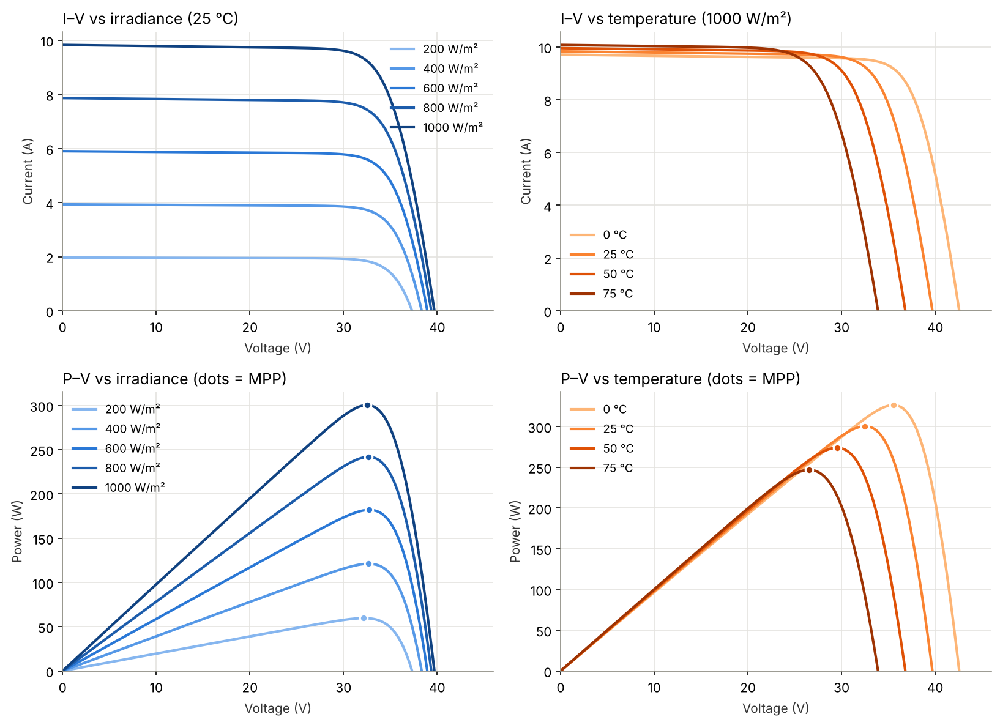
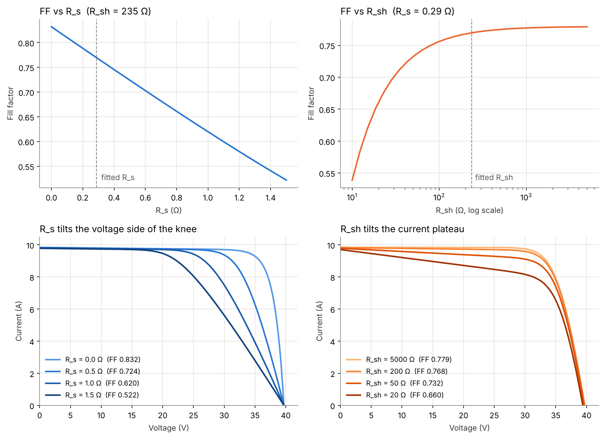

# Solar cell I–V curve modelling (single-diode model)

[](https://colab.research.google.com/github/YOUR-USERNAME/solar-iv-model/blob/main/solar_iv_model.ipynb)

A from-scratch Python implementation of the 5-parameter single-diode model for a real PV module (Canadian Solar CS6K-300MS, 60-cell mono-Si, 300 W), checked against `pvlib` and validated against datasheet values the model was not fitted to.

**[Read the full project report](REPORT.md)** · [Web version](https://YOUR-USERNAME.github.io/solar-iv-model/)



## Results

| Quantity (not used in the fit) | Datasheet | Model | Error |
|---|---|---|---|
| P_max at NOCT (800 W/m², 42 °C) | 222 W | 227.3 W | **+2.4 %** |
| γ (P_max temperature coefficient) | −0.39 %/°C | −0.353 %/°C | −9.5 % |
| Relative efficiency at 200 W/m² | 97.5 % | 99.3 % | +1.8 pts |

Fitted parameters at STC: I_ph = 9.842 A, I₀ = 2.24e-11 A, n = 0.961, R_s = 0.288 Ω, R_sh = 235 Ω. They match `pvlib.ivtools.sdm.fit_desoto` to better than 1e-6 %.

## What it does

1. **Parameter extraction.** Solves for I_ph, I₀, n, R_s and R_sh from the datasheet (I_sc, V_oc, I_mp, V_mp, β_Voc) with `scipy.optimize.least_squares`. The fifth equation is the V_oc temperature coefficient, using the De Soto temperature model.
2. **Implicit I–V solver, two ways.** A Lambert W solution in log space (avoids overflow near V_oc) and a Newton–Raphson solver with guaranteed monotone convergence. They agree to ~1e-14 A.
3. **Check against pvlib.** Same parameters, and pvlib's `singlediode` reproduces the same maximum power at 600 W/m², 50 °C.
4. **Sweeps.** I–V and P–V curves for 200–1000 W/m² and 0–75 °C, with the maximum power point for each case.
5. **Validation on unseen data.** NOCT operating point, P_max temperature coefficient, low-irradiance efficiency.
6. **Fill factor vs R_s and R_sh.**



R_s tilts the voltage side of the I–V knee; R_sh tilts the current plateau. FF falls about 0.02 per 0.1 Ω of R_s and collapses once R_sh drops below ~50 Ω.

## Run it

**In Colab:** click the badge above, then Runtime → Run all. The first cell installs `pvlib`.

**Locally:**

```bash
git clone https://github.com/YOUR-USERNAME/solar-iv-model.git
cd solar-iv-model
pip install -r requirements.txt
jupyter notebook solar_iv_model.ipynb
```

Figures are written to `figures/`.

## Repository layout

```
solar_iv_model.ipynb   notebook: model, fit, validation, plots
REPORT.md              full project report
index.html             web version of the report (GitHub Pages)
figures/               generated plots and the MPP grid (CSV)
requirements.txt
```

## References

- W. De Soto, S. A. Klein, W. A. Beckman, "Improvement and validation of a model for photovoltaic array performance", *Solar Energy* 80 (2006).
- A. Jain, A. Kapoor, "Exact analytical solutions of the parameters of real solar cells using Lambert W-function", *Solar Energy Materials and Solar Cells* 81 (2004).
- pvlib python: https://pvlib-python.readthedocs.io
- [Canadian Solar CS6K-300MS datasheet (v5.571)](https://csisolar.co.jp/wp-content/themes/canadian_solar/pdf/CS6K-300MS_v5.571.pdf)
