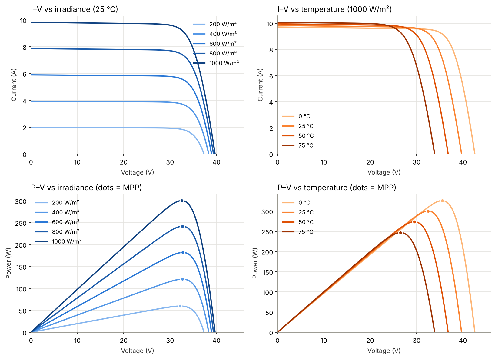
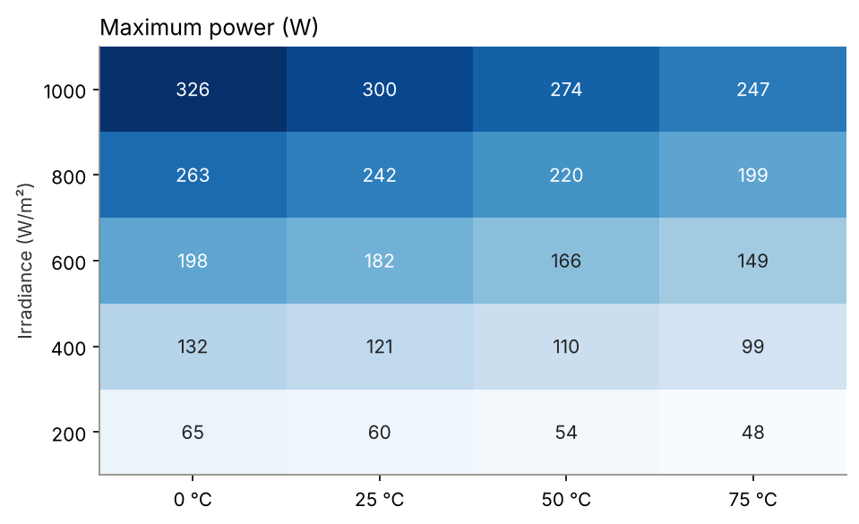
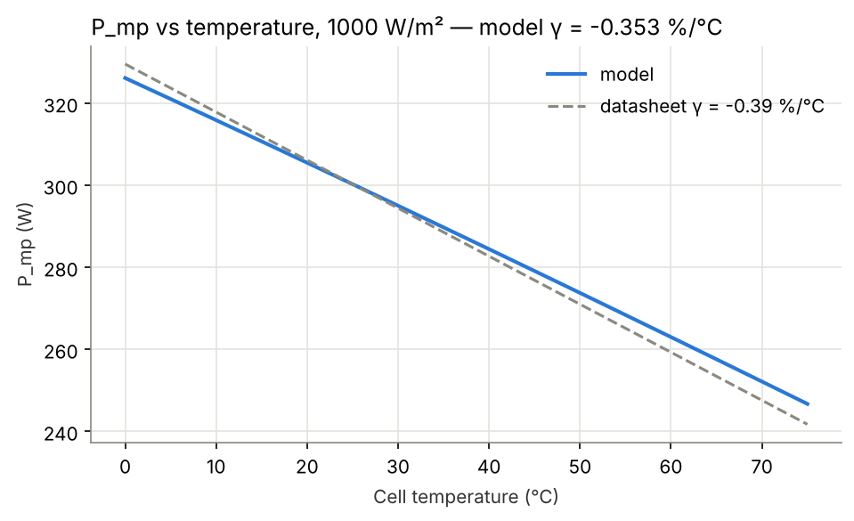
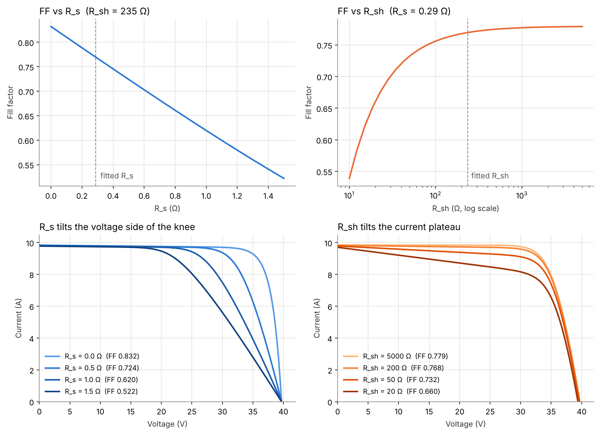
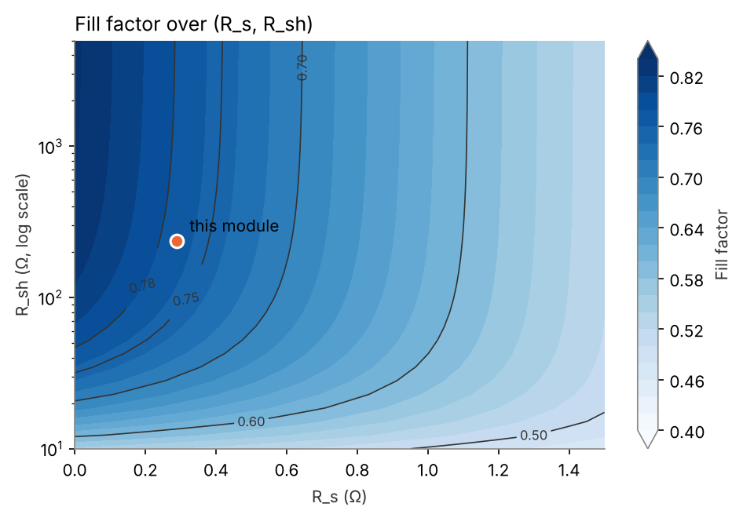

# Solar Cell I–V Curve Modelling: Project Report

## Abstract

A single-diode model of the Canadian Solar CS6K-300MS (300 W, 60-cell mono-Si) built from its datasheet predicts maximum power at NOCT within **+2.4 %** without being fitted to that point. The five model parameters were extracted with SciPy by solving five datasheet equations, and the implicit I–V equation was solved with both the Lambert W function and Newton–Raphson. The extracted parameters agree with pvlib's independent fit to better than 1e-6 %. The model reproduces the open-circuit voltage and short-circuit current temperature coefficients it was fitted to, but underestimates the magnitude of the maximum-power temperature coefficient by about 10 % (−0.353 vs −0.39 %/°C) and over-predicts low-irradiance efficiency (99.3 % vs 97.5 %). A parameter sweep shows how series and shunt resistance set the fill factor.

## 1. Introduction and objectives

A PV module datasheet gives performance at only a few operating points, but system design needs the full I–V curve at any irradiance and temperature. The single-diode equivalent circuit is the standard way to bridge that gap: five parameters, fitted once, describe the module everywhere.

Objectives:

1. Extract the five single-diode parameters from a real datasheet using numerical optimisation.
2. Solve the implicit I–V equation robustly with two independent methods.
3. Verify the implementation against the open-source library pvlib.
4. Compute I–V and P–V curves and the maximum power point for 200–1000 W/m² and 0–75 °C.
5. Validate the model against datasheet values it was not fitted to.
6. Quantify how series and shunt resistance affect the fill factor.

All code is in a single Python notebook ([`solar_iv_model.ipynb`](solar_iv_model.ipynb)) using NumPy, SciPy, pandas, Matplotlib and pvlib. It runs end to end in Google Colab.

## 2. Theory

### 2.1 Single-diode model

The module is modelled as a current source (photocurrent) in parallel with a diode and a shunt resistance, all in series with a series resistance:

$$
I = I_{ph} - I_0\left[\exp\left(\frac{V + I R_s}{a}\right) - 1\right] - \frac{V + I R_s}{R_{sh}}, \qquad a = n N_s \frac{kT}{q}
$$

| Parameter | Meaning | Physical origin |
| --- | --- | --- |
| I_ph | Photocurrent | Carriers generated by absorbed light; proportional to irradiance |
| I₀ | Diode saturation current | Recombination in the junction; rises steeply with temperature |
| n | Ideality factor | 1 for pure diffusion current, towards 2 for depletion-region recombination |
| R_s | Series resistance | Contacts, fingers, busbars, bulk and emitter resistance |
| R_sh | Shunt resistance | Leakage paths across the junction (edge defects, crystal faults) |

N_s = 60 cells in series, so the modified ideality factor *a* lumps n, the cell count and the thermal voltage kT/q (25.7 mV at 25 °C).

### 2.2 Explicit solution with Lambert W

The current appears on both sides, so the equation is implicit. It can be rearranged into closed form using the Lambert W function, the inverse of w·eʷ:

$$
I = \frac{R_{sh}(I_{ph}+I_0) - V}{R_s+R_{sh}} - \frac{a}{R_s}\,W(\theta), \qquad \theta = \frac{R_s R_{sh} I_0}{a(R_s+R_{sh})}\exp\left[\frac{R_{sh}(R_s I_{ph}+R_s I_0+V)}{a(R_s+R_{sh})}\right]
$$

Near open circuit the exponent in θ reaches several thousand, far beyond double-precision range. The implementation therefore works with ln θ and, when it exceeds 700, solves w + ln w = ln θ by Newton iteration instead of evaluating θ.

### 2.3 Translation to other conditions (De Soto model)

Parameters fitted at standard test conditions (1000 W/m², 25 °C) are translated to irradiance G and cell temperature T with the De Soto (2006) relations:

$$
I_{ph} = \frac{G}{G_{ref}}\left[I_{ph,ref} + \alpha_{sc}(T - T_{ref})\right], \qquad a = a_{ref}\frac{T}{T_{ref}}, \qquad R_{sh} = R_{sh,ref}\frac{G_{ref}}{G}
$$

$$
I_0 = I_{0,ref}\left(\frac{T}{T_{ref}}\right)^3 \exp\left[\frac{E_{g,ref}}{kT_{ref}} - \frac{E_g}{kT}\right], \qquad E_g = 1.121\ \text{eV}\left[1 - 0.0002677\,(T - T_{ref})\right]
$$

R_s is held constant. The strong temperature dependence of I₀ through the silicon bandgap is what makes V_oc fall as the cell heats up.

### 2.4 Fill factor

The fill factor FF = P_mp / (V_oc × I_sc) measures how square the I–V curve is. Series resistance drops a voltage I·R_s inside the cell, which matters most at high current; shunt resistance leaks a current V/R_sh, which matters most at high voltage. Both round the knee of the curve and lower FF.

## 3. Module and datasheet data

The [Canadian Solar CS6K-300MS](https://csisolar.co.jp/wp-content/themes/canadian_solar/pdf/CS6K-300MS_v5.571.pdf) (datasheet v5.571) was chosen because it is a common 60-cell monocrystalline module and is also in the CEC module database shipped with pvlib, giving an independent third parameter set to compare against. Values marked "Validation" were held out of the fit.

| Quantity | Value | Used for |
| --- | --- | --- |
| Short-circuit current I_sc (STC) | 9.83 A | Fit |
| Open-circuit voltage V_oc (STC) | 39.7 V | Fit |
| Current at max power I_mp (STC) | 9.24 A | Fit |
| Voltage at max power V_mp (STC) | 32.5 V | Fit |
| Max power P_max (STC) | 300 W | Fit (via I_mp × V_mp) |
| Cells in series N_s | 60 | Fit |
| Temperature coefficient of I_sc (α) | +0.05 %/°C | Fit |
| Temperature coefficient of V_oc (β) | −0.29 %/°C | Fit |
| Temperature coefficient of P_max (γ) | −0.39 %/°C | Validation |
| NOCT point (800 W/m², 42 °C): P_max / V_mp / I_mp | 222 W / 30.0 V / 7.40 A | Validation |
| NOCT point: V_oc / I_sc | 37.2 V / 7.93 A | Validation |
| Relative efficiency at 200 W/m² vs 1000 W/m² | 97.5 % | Validation |

The NOCT operating point is given at 20 °C ambient, 1 m/s wind; the datasheet's nominal module temperature for these conditions, 42 °C, was used as the cell temperature.

## 4. Methodology

### 4.1 Parameter extraction

The datasheet supplies three points and one slope condition, only four equations for five unknowns. The fifth comes from the V_oc temperature coefficient, the same closure used by the CEC/SAM database:

| # | Condition | Equation |
| --- | --- | --- |
| 1 | Short circuit | I(0) = I_sc |
| 2 | Open circuit | I(V_oc) = 0 |
| 3 | Maximum power point | I(V_mp) = I_mp |
| 4 | MPP is a maximum (dP/dV = 0) | dI/dV at MPP = −I_mp / V_mp |
| 5 | V_oc temperature coefficient | V_oc(25 °C + ΔT) = V_oc + β·ΔT, with ΔT = 2 K |

The slope in equation 4 comes from implicit differentiation of the diode equation: dI/dV = −g / (1 + R_s·g), where g = (I₀/a)·exp((V + I·R_s)/a) + 1/R_sh. Equation 5 evaluates V_oc with the De Soto translation and a bracketed root search (`brentq`).

The system was solved with `scipy.optimize.least_squares` (trust-region reflective, with bounds). Three choices made it robust:

- **Log variables.** I₀ (about 1e-11 A) and R_sh were solved as ln I₀ and ln R_sh, so all unknowns are of similar size.
- **Dimensionless residuals.** Current residuals were divided by I_sc, the slope residual by I_mp/V_mp, and the voltage residual by V_oc.
- **Generic start.** n = 1.1, R_s = 0.3 Ω, R_sh = 300 Ω, I_ph = I_sc, with I₀ from the open-circuit condition. Bounds kept n in 0.7–2 and R_s in 0–2 Ω.

### 4.2 Solving for current

Two independent solvers were written and compared over 400 voltages from 0 to V_oc:

- **Lambert W**, in log space as described in section 2.2.
- **Newton–Raphson** on f(I) = 0. Because f is decreasing and concave in I, a start at I = I_ph (where f < 0) converges monotonically without damping.

### 4.3 Verification against pvlib

The same datasheet inputs were passed to `pvlib.ivtools.sdm.fit_desoto`, and the fitted parameters were translated to 600 W/m², 50 °C with both this code and `pvlib.pvsystem.calcparams_desoto`, then solved with `pvlib.pvsystem.singlediode`. pvlib's fitter uses an unbounded root finder that failed from its default start for this module, so it was given a rounded starting guess.

### 4.4 Sweeps and maximum power point

Curves were computed for irradiance 200, 400, 600, 800 and 1000 W/m² at 25 °C, and for temperature 0, 25, 50 and 75 °C at 1000 W/m². At each condition the MPP was found by maximising P = V·I(V) with bounded scalar minimisation (`minimize_scalar`, tolerance 1e-8 V) between 0 and V_oc.

### 4.5 Validation

Model output was compared with held-out datasheet values: the NOCT operating point; γ, obtained from a linear fit of P_mp over 0–75 °C at 1000 W/m²; and relative efficiency at 200 W/m².

### 4.6 Fill factor study

With I_ph, I₀ and n fixed at their fitted values, R_s was swept from 0 to 1.5 Ω and R_sh from 10 to 5000 Ω (log spaced), one at a time and on a 31 × 31 grid, recording FF at STC.

## 5. Results

### 5.1 Extracted parameters and verification

The fit converged with a largest residual of 1.7e-15, and every parameter matches pvlib's independent fit to within 4e-7 %.

| Parameter | This work | pvlib fit_desoto | CEC database |
| --- | --- | --- | --- |
| I_ph (A) | 9.842 | 9.842 | 9.702 |
| I₀ (A) | 2.240e-11 | 2.240e-11 | 7.212e-11 |
| n (per cell) | 0.961 | 0.961 | 1.005 |
| a = n·N_s·V_t (V) | 1.482 | 1.482 | 1.549 |
| R_s (Ω) | 0.288 | 0.288 | 0.263 |
| R_sh (Ω) | 235.3 | 235.3 | 1117 |

The CEC entry differs because it was fitted to an older datasheet revision (I_sc = 9.70 A, I_mp = 9.20 A, V_mp = 32.6 V) and uses a sixth adjustment parameter; the difference is in the inputs, not the method.

Further checks:

- Lambert W and Newton–Raphson currents agree to **1.6e-14 A** across the full curve.
- The model returns I(0) = 9.8300 A, I(V_mp) = 9.2400 A and I(V_oc) ≈ 4e-15 A, reproducing the datasheet points exactly.
- At 600 W/m², 50 °C, this code and pvlib give identical translated parameters and the same P_mp of **165.726 W**.

### 5.2 I–V and P–V curves

Irradiance scales the current almost linearly, while temperature mainly shifts the voltage: V_oc falls from 42.6 V at 0 °C to 33.9 V at 75 °C, and P_mp falls from 326 W to 247 W.

*Figure 1. I–V (top) and P–V (bottom) curves for 200–1000 W/m² at 25 °C (left) and 0–75 °C at 1000 W/m² (right). Dots mark the maximum power point.*

### 5.3 Maximum power point

P_mp ranges from 48 W (200 W/m², 75 °C) to 326 W (1000 W/m², 0 °C). V_mp stays near 32–33 V across irradiance at 25 °C, which is why simple MPPT algorithms can track a narrow voltage window. The full grid is in [`figures/mpp_grid.csv`](figures/mpp_grid.csv).

*Figure 2. Maximum power (W) for every irradiance and temperature combination.*

### 5.4 Validation against held-out datasheet values

| Quantity (not used in fit) | Datasheet | Model | Error |
| --- | --- | --- | --- |
| P_max at NOCT | 222 W | 227.3 W | **+2.4 %** |
| V_mp at NOCT | 30.0 V | 30.6 V | +2.0 % |
| I_mp at NOCT | 7.40 A | 7.43 A | +0.4 % |
| V_oc at NOCT | 37.2 V | 37.4 V | +0.5 % |
| I_sc at NOCT | 7.93 A | 7.93 A | +0.0 % |
| γ, P_max temperature coefficient | −0.39 %/°C | −0.353 %/°C | −9.5 % |
| Relative efficiency at 200 W/m² | 97.5 % | 99.3 % | +1.8 points |

The coefficients that were part of the fit come back as expected: β = −0.291 %/°C (datasheet −0.29) and α = +0.050 %/°C (datasheet +0.05). At STC every fitted quantity matches to 0.00 %, which confirms the solver but is not evidence of accuracy.

*Figure 3. P_mp against cell temperature at 1000 W/m². The model's slope (γ = −0.353 %/°C) is shallower than the datasheet's −0.39 %/°C.*

### 5.5 Effect of series and shunt resistance on fill factor

The fitted module has FF = 0.770, matching the datasheet value of 0.7695. FF falls almost linearly with R_s, from 0.832 at 0 Ω to 0.522 at 1.5 Ω, about 0.21 per ohm. It is insensitive to R_sh above a few hundred ohms (0.779 at 5000 Ω, 0.768 at 200 Ω) but collapses below about 50 Ω (0.660 at 20 Ω, 0.54 at 10 Ω).

*Figure 4. Fill factor against R_s and R_sh (top), and I–V curves showing R_s tilting the voltage side of the knee and R_sh tilting the current plateau (bottom).*

*Figure 5. Fill factor over the (R_s, R_sh) plane; the dot marks the fitted module.*

This module sits where FF is far more sensitive to R_s than to R_sh: a 0.1 Ω increase in R_s costs about 2 FF points, roughly what a fall in R_sh from 235 Ω to 100 Ω would cost.

## 6. Discussion

The implementation is correct; the remaining errors come from the five-parameter model itself.

**Accuracy at NOCT.** The model over-predicts NOCT power by 2.4 %, almost entirely through V_mp (+2.0 %) rather than current (+0.4 %). Two effects contribute. First, the model's temperature sensitivity of power is too weak (below), and NOCT is 17 °C above STC. Second, the datasheet NOCT row is a measured module result that includes losses (spectral and angular effects, real module temperature distribution) the model does not represent.

**Temperature coefficient of power.** The model gives γ = −0.353 %/°C against −0.39 %/°C. The De Soto model is constrained only by α (current) and β (voltage); how the fill factor changes with temperature is left to the diode physics. A single diode with n fixed and R_s constant underestimates the fill-factor loss as the cell heats. The CEC/SAM six-parameter model exists largely to correct this: its "Adjust" parameter tunes the temperature behaviour so that γ also matches.

**Low irradiance.** Relative efficiency at 200 W/m² is over-predicted (99.3 % vs 97.5 %). In the model, R_sh rises as 1/G, so shunt losses shrink at low light, and the I²R_s loss shrinks with current, so efficiency barely drops. Real modules lose more at low light, through effects such as second-diode recombination that a single diode does not capture.

**Ideality factor below 1.** The fit gives n = 0.961 per cell, slightly below the ideal-diode value of 1. This is an effective, fitted parameter, not a measured one: forcing the model to reproduce β exactly pulls n down. The CEC fit to an older datasheet gives n = 1.005, showing how sensitive n is to small input changes.

**Low shunt resistance.** The fitted R_sh of 235 Ω is about five times lower than the CEC value. R_sh is set mainly by the slope condition at the MPP, and small changes in the datasheet I_mp and V_mp move it a lot. In section 5.5 the fill factor is insensitive to R_sh in this range, so this uncertainty has little effect on predicted power.

**Numerical robustness.** pvlib's fitter, which uses an unbounded root finder, failed from its default start for this module and needed a starting guess close to the answer. The bounded least-squares formulation with log-scaled variables converged from a generic start, which matters if the method is to be applied to many modules automatically.

## 7. Conclusion and future work

A single-diode model fitted only to STC values and two temperature coefficients predicts the NOCT maximum power of the CS6K-300MS within 2.4 %, and its implementation matches pvlib to machine precision. Its weaknesses are a 10 % underestimate of the power temperature coefficient and optimistic low-light efficiency, both known limits of the five-parameter model. Series resistance dominates fill-factor sensitivity for this module: each 0.1 Ω costs about 2 FF points.

Possible extensions:

- Fit n = 1 and drop the β equation, then compare γ and NOCT errors with this fit.
- Add the CEC "Adjust" parameter, or a second diode, and test whether γ and low-light efficiency improve.
- Make R_s depend on temperature and irradiance.
- Validate against measured I–V curves (for example NREL's public module datasets) instead of datasheet points.
- Repeat the fit across many modules in the CEC database to study the spread of n and R_sh.

## References

1. W. De Soto, S. A. Klein, W. A. Beckman, "Improvement and validation of a model for photovoltaic array performance", *Solar Energy* 80(1), 78–88, 2006.
2. A. Jain, A. Kapoor, "Exact analytical solutions of the parameters of real solar cells using Lambert W-function", *Solar Energy Materials and Solar Cells* 81(2), 269–277, 2004.
3. A. P. Dobos, "An improved coefficient calculator for the California Energy Commission 6 parameter photovoltaic module model", *Journal of Solar Energy Engineering* 134(2), 2012.
4. K. S. Anderson et al., "pvlib python: 2023 project update", *Journal of Open Source Software* 8(92), 5994, 2023. [pvlib documentation](https://pvlib-python.readthedocs.io)
5. Canadian Solar, [CS6K-300MS datasheet v5.571](https://csisolar.co.jp/wp-content/themes/canadian_solar/pdf/CS6K-300MS_v5.571.pdf).
